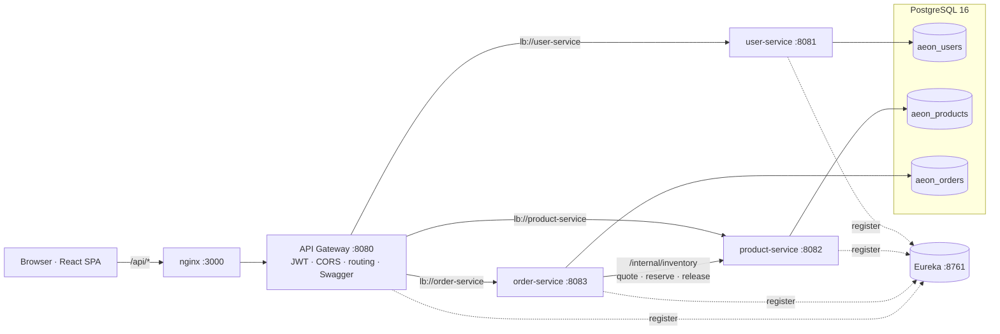
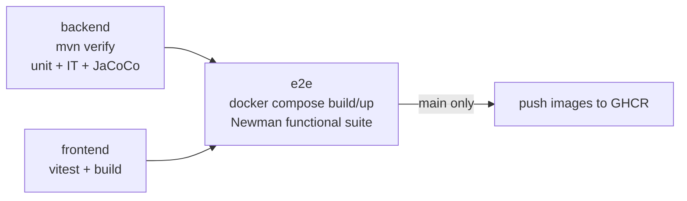

# WatchesDen — Full-Stack E-Commerce (Use Case 2: Order & Inventory)

A watch store with a **Customize Your Watch** feature and a deliberately simple React UI whose job is to exercise the backend, built as **Spring Boot microservices** behind an
**API gateway**, a **React** frontend, **PostgreSQL**, **Docker Compose** and a **GitHub Actions** CI/CD pipeline.

| | |
|---|---|
| Web app (React) | http://localhost:3000 |
| **Swagger UI (all services, via gateway)** | **http://localhost:8080/swagger-ui.html** |
| API gateway | http://localhost:8080 |
| Eureka dashboard | http://localhost:8761 |
| Postman collection | [`postman/WatchesDen.postman_collection.json`](postman/WatchesDen.postman_collection.json) + [`WatchesDen.local.postman_environment.json`](postman/WatchesDen.local.postman_environment.json) |
| Technical document | [`docs/TECHNICAL_DOC.md`](docs/TECHNICAL_DOC.md) |
| Roadmap | [`ROADMAP.md`](ROADMAP.md) |
| Test results | [`docs/TEST_RESULTS.md`](docs/TEST_RESULTS.md) |

Seeded admin login: **admin@watchesden.com / Admin@123** (override with `ADMIN_EMAIL` / `ADMIN_PASSWORD`).

---

## 1. Features

| Requirement | Where |
|---|---|
| User registration / login | `user-service` (BCrypt + JWT), `/login`, `/register` |
| Product listing & search | `product-service` – text, collection, price range, customizable filter, sort, paging |
| Product listing & search | `/` – search box, collection, min/max price, sort, customizable filter, paging |
| Product details | `/product/:id` – image, specs table, quantity, add to cart |
| **Watch customization** | `/customize` – choose case / dial / strap / hands; price re-computed server-side |
| Shopping cart | `/cart` (`order-service`) – merge identical configurations, live pricing, update/remove |
| Basic checkout | Saga: reserve stock → persist order → compensate on failure; `Idempotency-Key` support |
| Order history | `/orders` – status timeline, cancel (stock is returned) |
| Admin product management (CRUD) | `/admin` – create / edit (live colour preview) / deactivate; order fulfilment |

Use-case-2 focus areas: **concurrency** (atomic conditional stock decrement, optimistic locking, idempotent checkout —
proven by a 20-thread no-oversell test), **events** (`OrderEvent` published after commit), **scalability** (stateless
services, service discovery, client-side load balancing, database-per-service).

## 2. Architecture overview



- **MVC** in every service: `controller` → `service` → `repository` → `model`, with immutable DTOs at the boundary.
- **`common`** is the shared library that connects the services: error model + global exception handler, JWT issue/verify,
  identity-header contract (`X-User-Id`, `X-User-Role`), correlation-ID logging filter, pagination envelope. It is wired in
  through Spring Boot auto-configuration, so each service gets it by adding one dependency.
- **API gateway** validates the JWT once, strips spoofed identity headers, injects trusted ones, and routes via Eureka.
- **Database per service** (three databases on one PostgreSQL instance), each migrated by its own Flyway scripts.

Full design rationale, sequence diagrams and data model: [docs/TECHNICAL_DOC.md](docs/TECHNICAL_DOC.md).

## 3. Project structure

```
watch-website/
├── backend/                     Maven multi-module (Java 11, Spring Boot 2.7, Spring Cloud 2021)
│   ├── common/                  shared library (exceptions, JWT, headers, logging, auto-config)
│   ├── discovery-server/        Eureka registry
│   ├── api-gateway/             Spring Cloud Gateway + JWT filter + aggregated Swagger
│   ├── user-service/            auth & profile          → aeon_users
│   ├── product-service/         catalog, options, admin CRUD, inventory → aeon_products
│   ├── order-service/           cart, checkout, orders, admin orders     → aeon_orders
│   └── Dockerfile               one multi-stage image definition for every module (ARG SERVICE)
├── frontend/                    React 18 + Vite, plain CSS (simple UI to demo the APIs)
│   ├── src/components/          Navbar, ProductCard, ProtectedRoute, Loader
│   ├── src/pages/               Products, ProductDetail, Customize, Cart, Checkout, Orders, Admin, Login/Register
│   ├── src/context/             Auth, Cart, Toast providers
│   ├── src/api/                 fetch client + endpoint wrappers
│   ├── src/test/                Vitest + Testing Library
│   ├── Dockerfile, nginx.conf
├── db/init.sql                  creates the three service databases
├── postman/                     functional test collection + environment
├── docs/                        TECHNICAL_DOC.md, TEST_RESULTS.md
├── .github/workflows/ci.yml     CI/CD pipeline
├── docker-compose.yml
├── run-local.sh / run-local.bat  start the backend without Docker (H2 databases)
└── ROADMAP.md
```

## 4. Setup

### Option A — Docker (recommended)

Prerequisites: Docker Desktop (or Docker Engine + Compose v2), ~4 GB RAM free.

```bash
docker compose up --build        # first build takes a few minutes (Maven + npm downloads)
```

Open http://localhost:3000. Services start in dependency order using health checks.
Stop with `docker compose down` (add `-v` to wipe the database).

### Option B — Run locally without Docker or PostgreSQL (quickest)

Prerequisites: **JDK 11+** and Node 18+. Maven is not needed: the bundled wrapper (`backend/mvnw`) downloads it.
The `local` Spring profile swaps PostgreSQL for embedded H2 databases stored in `~/.watchesden`
(override with `AEON_DATA_DIR`). Flyway runs the same migrations, so the catalog is seeded on first start.

```bash
./run-local.sh                 # macOS / Linux: builds on first run, starts all 5 services; Ctrl+C stops them
run-local.bat                  # Windows: opens one window per service

cd frontend && npm install && npm run dev      # http://localhost:3000
```

Logs go to `logs/<service>.log` (shell script). Delete `~/.watchesden` to reset the data.

### Option C — Run locally with PostgreSQL

Prerequisites: JDK 11+, Node 18+, PostgreSQL 14+.

```bash
# 1. databases
psql -U postgres -c "CREATE USER aeon WITH PASSWORD 'aeon';"
psql -U postgres -c "ALTER USER aeon CREATEDB;"
psql -U aeon -d postgres -f db/init.sql

# 2. backend (each in its own terminal, in this order)
cd backend && ./mvnw -q install -DskipTests
java -jar discovery-server/target/discovery-server-1.0.0.jar
java -jar user-service/target/user-service-1.0.0.jar
java -jar product-service/target/product-service-1.0.0.jar
java -jar order-service/target/order-service-1.0.0.jar
java -jar api-gateway/target/api-gateway-1.0.0.jar

# 3. frontend (proxies /api to :8080)
cd frontend && npm install && npm run dev      # http://localhost:3000
```

### Configuration

| Variable | Default | Used by |
|---|---|---|
| `JWT_SECRET` | dev value (≥ 32 bytes) — **change in any shared environment** | gateway, user-service |
| `DB_URL`, `DB_USER`, `DB_PASSWORD` | `jdbc:postgresql://localhost:5432/aeon_<svc>`, `aeon`, `aeon` | services |
| `EUREKA_URL` | `http://localhost:8761/eureka` | all |
| `ADMIN_EMAIL`, `ADMIN_PASSWORD` | `admin@watchesden.com`, `Admin@123` | user-service seeder |
| `CORS_ORIGINS` | `http://localhost:*` | gateway |

## 5. API details

All client traffic goes through the gateway on **:8080**. Interactive docs: **http://localhost:8080/swagger-ui.html**
(service selector top-right; click *Authorize* and paste a token from `/api/auth/login`).

| Method | Path | Auth | Description |
|---|---|---|---|
| POST | `/api/auth/register` | – | Create customer, returns JWT |
| POST | `/api/auth/login` | – | Returns JWT |
| GET | `/api/users/me` | user | Profile |
| GET | `/api/products` | – | Search: `q`, `collection`, `minPrice`, `maxPrice`, `customizable`, `page`, `size`, `sort` |
| GET | `/api/products/{id}` | – | Details |
| GET | `/api/products/collections` | – | Collection names |
| GET | `/api/customizations` | – | Configurator options grouped by part |
| GET | `/api/cart` | user | Cart with live prices |
| POST | `/api/cart/items` | user | Add `{productId, quantity, optionIds[]}` |
| PATCH | `/api/cart/items/{id}` | user | Change quantity |
| DELETE | `/api/cart/items/{id}` · `/api/cart` | user | Remove line · empty cart |
| POST | `/api/orders/checkout` | user | Place order; optional `Idempotency-Key` header |
| GET | `/api/orders` · `/api/orders/{id}` | user | History · details (owner only) |
| POST | `/api/orders/{id}/cancel` | user | Cancel (PLACED/CONFIRMED), returns stock |
| GET/POST | `/api/admin/products` | admin | List all · create |
| PUT/DELETE | `/api/admin/products/{id}` | admin | Update · deactivate |
| GET | `/api/admin/orders?status=` | admin | All orders |
| PATCH | `/api/admin/orders/{id}/status` | admin | `PLACED→CONFIRMED→SHIPPED→DELIVERED`, or `CANCELLED` |

Errors share one shape: `{timestamp, status, error, message, path, correlationId, fieldErrors}`.

## 6. Running tests

```bash
# Backend: unit tests (surefire, *Test) + integration tests (failsafe, *IT) + JaCoCo coverage
cd backend && ./mvnw verify
#   reports: */target/surefire-reports, */target/failsafe-reports, */target/site/jacoco/index.html

# Frontend: Vitest + Testing Library
cd frontend && npm test            # or: npm run test:coverage

# Functional / end-to-end, against a running stack
npx newman run postman/WatchesDen.postman_collection.json -e postman/WatchesDen.local.postman_environment.json
```

Latest results (66 backend + 18 frontend tests, 43 Postman requests / 114 assertions — all passing):
[docs/TEST_RESULTS.md](docs/TEST_RESULTS.md).

## 7. CI/CD pipeline

[`.github/workflows/ci.yml`](.github/workflows/ci.yml) runs on every push and pull request:



Test results are published as GitHub check runs (JUnit reports) and uploaded as artifacts (incl. coverage).
Deployment to AWS (ECS Fargate + RDS) is planned in [ROADMAP.md](ROADMAP.md#phase-3--cloud-deployment-aws).

## 8. Assumptions & limitations

- `aeon` is the internal codename: Java packages (`com.aeon.*`), database names (`aeon_*`) and config keys (`aeon.*`) keep it, and everything customer-facing is branded **WatchesDen**.
- **Payments are simulated**: the user picks CARD / UPI / COD and no payment details are collected. A real PSP is on the roadmap.
- Stock is reserved synchronously over REST at checkout; there is no message broker yet. `OrderEvent`s are published
  in-process after commit, which is where a Kafka producer plugs in (roadmap phase 2).
- If stock compensation fails after a failed checkout, it is logged as `COMPENSATION FAILED` for reconciliation;
  a transactional outbox will make this automatic.
- Downstream services trust `X-User-*` headers because they are reachable only on the private network, behind the gateway,
  which strips client-supplied copies. In production, add mTLS or network policies between services.
- Prices are in INR and shown as inclusive of taxes; tax breakdown and shipping cost are not modelled (shipping shown as free).
- Product photos are Unsplash stock images (free licence), hot-linked from the Unsplash CDN. They show real-world watches standing in for the fictional catalogue.
- The UI is intentionally basic (plain CSS, tables and forms); the focus of the project is the backend.
- Integration tests run on H2 in PostgreSQL mode for speed and portability; the Docker/Newman stage covers real PostgreSQL.
- The JWT is stored in `localStorage` for simplicity; an httpOnly-cookie session is a planned hardening step.
