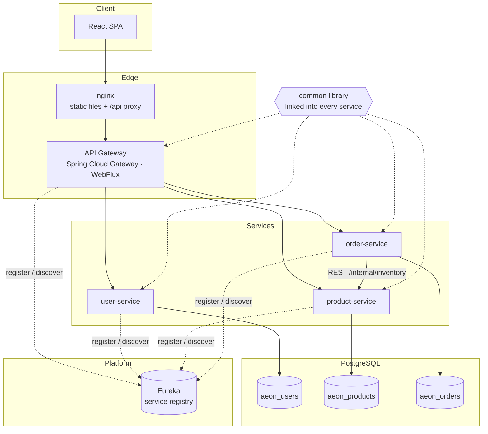
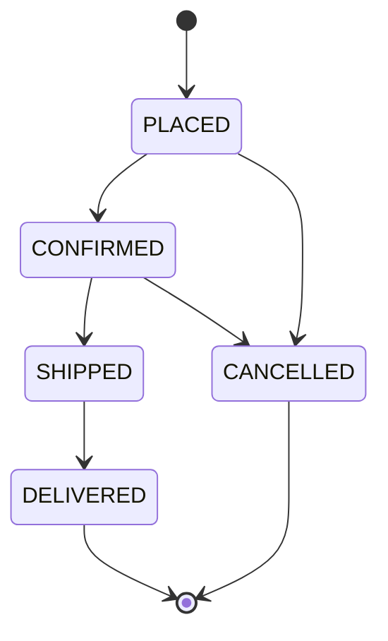
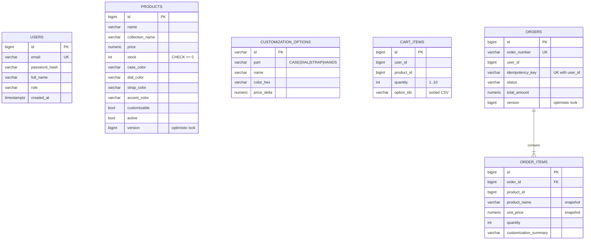

# WatchesDen — Technical Document

This document explains how the WatchesDen platform is built and why it is built that way: architecture, every service, the
data model, security, the checkout saga and concurrency controls, the animated frontend, testing, containers and CI/CD.

- [1. Scope](#1-scope)
- [2. Technology stack](#2-technology-stack)
- [3. System architecture](#3-system-architecture)
- [4. Request lifecycle](#4-request-lifecycle)
- [5. Security model](#5-security-model)
- [6. The `common` library](#6-the-common-library)
- [7. Services](#7-services)
- [8. Data model](#8-data-model)
- [9. Checkout saga](#9-checkout-saga)
- [10. Concurrency & consistency](#10-concurrency--consistency)
- [11. Events](#11-events)
- [12. Error handling & validation](#12-error-handling--validation)
- [13. Logging & observability](#13-logging--observability)
- [14. Frontend](#14-frontend)
- [15. Testing strategy](#15-testing-strategy)
- [16. Containers & local orchestration](#16-containers--local-orchestration)
- [17. CI/CD](#17-cicd)
- [18. Configuration reference](#18-configuration-reference)
- [19. Design decisions & trade-offs](#19-design-decisions--trade-offs)

---

## 1. Scope

The assessment's **Use Case 2 — E-Commerce Order & Inventory** (focus: events, messaging, concurrency, scalability),
applied to a watch store whose differentiator is **customization**: customers pick a base model and then a case, dial,
strap and hands, see the result rendered live, and buy it.

Minimum features covered: registration/login, product listing & search, product details, cart, basic checkout,
order history, admin product CRUD. Additions: watch configurator, admin order fulfilment, order cancellation with
stock return, idempotent checkout.

## 2. Technology stack

| Layer | Technology | Version | Why |
|---|---|---|---|
| Language | Java | 11 (LTS) | Runs on the widest range of machines; long-term support |
| Framework | Spring Boot | 2.7.18 | MVC, Data JPA, validation, actuator (last line supporting Java 11) |
| Microservice infra | Spring Cloud | 2021.0.9 | Gateway, Netflix Eureka, LoadBalancer |
| API docs | springdoc-openapi | 1.8.0 | OpenAPI 3 + Swagger UI, aggregated at the gateway |
| Auth | jjwt | 0.12.6 | HS256 JWT issue/verify |
| Passwords | spring-security-crypto | (Boot managed) | BCrypt without pulling in full Spring Security |
| Database | PostgreSQL | 16 | Database-per-service (embedded H2 with the `local` profile for Docker-free runs) |
| Migrations | Flyway | 8.5 (Boot managed) | Versioned, repeatable schema per service |
| Frontend | React | 18.3 | Component model, hooks |
| Build tool | Vite | 5 | Fast dev server with API proxy |
| Routing | React Router | 6 | Nested routes, protected routes |
| Backend tests | JUnit 5, Mockito, AssertJ, MockMvc, H2 | Boot managed | Unit + integration |
| Frontend tests | Vitest, Testing Library, jsdom | 2 / 16 | Fast, Jest-compatible |
| Functional tests | Postman + Newman | 6 | Black-box tests through the gateway |
| Containers | Docker, Docker Compose | Compose v2 | One-command environment |
| CI/CD | GitHub Actions, GHCR | – | Build, test, e2e, publish images |

## 3. System architecture



| Component | Port | Responsibility |
|---|---|---|
| `frontend` (nginx) | 3000→80 | Serves the SPA, proxies `/api/*` to the gateway (same origin, no CORS in production) |
| `api-gateway` | 8080 | Single entry point. Routing, JWT validation, identity-header injection, CORS, correlation IDs, aggregated Swagger UI |
| `discovery-server` | 8761 | Eureka registry; services resolve each other by name (`lb://product-service`) |
| `user-service` | 8081 | Accounts, BCrypt password hashing, JWT issuing, profile, admin seeding |
| `product-service` | 8082 | Catalog, search, configurator options, admin CRUD, **inventory** (quote/reserve/release) |
| `order-service` | 8083 | Cart, checkout saga, orders, cancellation, admin fulfilment, order events |
| `postgres` | 5432 | Three logical databases, one per service |

**Why these service boundaries?** Each service owns one aggregate and its data: *identity*, *catalog + stock*,
*purchase intent + orders*. Stock lives with the catalog because every stock rule (reserve, release, never negative)
needs the product row; putting it elsewhere would require distributed locking.

### MVC inside every service

```
com.aeon.<service>
├── controller   HTTP layer: routing, @Valid, identity headers → calls service
├── service      business rules & transactions
├── repository   Spring Data JPA interfaces, specifications, atomic queries
├── model        JPA entities (the "M")
├── dto          immutable request/response DTOs (the API "V" — JSON views of the model)
├── client       (order-service) typed client for another service
├── event        (order-service) domain events + listener
└── config       beans, OpenAPI metadata
```

Controllers never touch repositories; entities never leave the service layer (they are mapped to DTOs).

## 4. Request lifecycle

```mermaid
sequenceDiagram
  autonumber
  participant B as Browser
  participant G as API Gateway
  participant E as Eureka
  participant O as order-service
  B->>G: GET /api/cart (Authorization: Bearer JWT)
  G->>G: JwtAuthenticationFilter: verify signature + expiry
  G->>G: strip client X-User-*; add X-User-Id/Email/Role, X-Correlation-Id
  G->>E: resolve lb://order-service
  G->>O: GET /api/cart + identity headers
  O->>O: CorrelationIdFilter puts id in MDC (every log line tagged)
  O->>O: CartController → CartService → repository
  O-->>G: 200 JSON (X-Correlation-Id)
  G-->>B: 200 JSON
```

## 5. Security model

**Authentication.** `POST /api/auth/login` checks the BCrypt hash and returns an HS256 JWT
(`sub` = user id, claims `email`, `role`, 24 h TTL). The shared secret (`JWT_SECRET`, at least 32 bytes, enforced at
startup) is known only to the gateway and user-service.

**Gateway enforcement** ([`RoutePolicy`](../backend/api-gateway/src/main/java/com/aeon/gateway/security/RoutePolicy.java),
[`JwtAuthenticationFilter`](../backend/api-gateway/src/main/java/com/aeon/gateway/security/JwtAuthenticationFilter.java)):

| Path | Rule |
|---|---|
| `/api/auth/**`, Swagger, `/actuator/health`, `OPTIONS *` | public |
| `GET /api/products/**`, `GET /api/customizations` | public |
| `/api/admin/**` | valid token **and** role `ADMIN` (403 otherwise) |
| everything else routed | valid token (401 otherwise) |
| `/internal/**` | **no route exists**, so the gateway returns 404; reachable only inside the Docker network |

**Header-spoofing defence.** The gateway always deletes incoming `X-User-Id`, `X-User-Email` and `X-User-Role`, then sets them
from the verified token. The Postman suite checks this: a customer token with `X-User-Role: ADMIN` still gets 403.

**Defence in depth.** Each service re-checks what it needs (`AuthHeaders.requireUser`, `AuthHeaders.requireAdmin`), so a
misconfigured route can't skip authorization. Order reads are owner-scoped: another user's order returns 404, not 403,
so order IDs can't be enumerated.

**Other controls.** Bean Validation on every request DTO; parameterised JPA queries only; page size capped at 50;
passwords 8–72 characters (BCrypt's limit) with a letter and a digit; no payment data is collected; containers run
as a non-root user; CORS is limited to configured origins.

## 6. The `common` library

`common` is the shared module that connects every microservice. It is a plain JAR with **Spring Boot
auto-configuration** (`META-INF/spring/...AutoConfiguration.imports`), so adding the dependency is enough.

| Package | Provides |
|---|---|
| `exception` | `ApiException` hierarchy (`ResourceNotFoundException` 404, `BusinessException` 409/400, `UnauthorizedException` 401/403), `ApiError` body, `GlobalExceptionHandler` |
| `security` | `JwtService` (issue/verify), `AuthUser`, `Roles`, `AuthHeaders` (header names + guards) |
| `logging` | `CorrelationId` constants, `CorrelationIdFilter` (MDC + access log line per request) |
| `dto` | `PageResponse<T>`: a stable pagination envelope instead of Spring's internal `Page` JSON |
| `config` | `CommonWebAutoConfiguration` (servlet services only), `JwtAutoConfiguration` (when `aeon.jwt.secret` is set) |

Servlet dependencies are `optional`, so the **reactive** gateway can reuse `JwtService` without pulling in Spring MVC, which
would break Spring Cloud Gateway.

## 7. Services

### 7.1 user-service

| Endpoint | Notes |
|---|---|
| `POST /api/auth/register` | Email trimmed + lower-cased; duplicate → 409; returns `AuthResponse{token, tokenType, expiresIn, user}` |
| `POST /api/auth/login` | Unknown email and wrong password give the same 401 message (prevents account enumeration) |
| `GET /api/users/me` | From `X-User-Id` |

On startup an `ApplicationRunner` seeds the admin account if it is missing (idempotent).

### 7.2 product-service

| Endpoint | Notes |
|---|---|
| `GET /api/products` | Composable JPA `Specification`s: `activeOnly ∧ matchesText ∧ inCollection ∧ priceBetween ∧ customizable`; pageable + sortable |
| `GET /api/products/{id}` | Active products only |
| `GET /api/products/collections` | Distinct active collections (filter chips) |
| `GET /api/customizations` | Options grouped by part: `CASE`, `DIAL`, `STRAP`, `HANDS` |
| `/api/admin/products` (GET, POST, PUT `{id}`, DELETE `{id}`) | Admin CRUD. DELETE is a **soft delete** (`active=false`) so historic orders stay valid |
| `POST /internal/inventory/quote` | Prices lines (base + option deltas) without touching stock; removed products come back `available=false` |
| `POST /internal/inventory/reserve` | All-or-nothing stock reservation (see §10) |
| `POST /internal/inventory/release` | Compensation: returns stock |

**Customization pricing** is computed on the server. The client sends option IDs, never prices.
`unitPrice = product.price + Σ option.priceDelta`. The service rejects options for non-customizable products, unknown
option IDs, and more than one option per part.

### 7.3 order-service

| Endpoint | Notes |
|---|---|
| `GET /api/cart` | Re-priced live through `/internal/inventory/quote` on every read, so the cart never shows stale prices |
| `POST /api/cart/items` | Validates via quote first. Lines with the same product **and** option set are merged, regardless of option order. Max 10 per line, 20 lines |
| `PATCH/DELETE /api/cart/items/{id}`, `DELETE /api/cart` | Owner-scoped |
| `POST /api/orders/checkout` | Saga (see §9). Optional `Idempotency-Key` |
| `GET /api/orders`, `GET /api/orders/{id}` | Newest first; owner-scoped |
| `POST /api/orders/{id}/cancel` | Allowed from `PLACED` / `CONFIRMED`; releases stock |
| `GET /api/admin/orders?status=` / `PATCH /api/admin/orders/{id}/status` | Fulfilment via a state machine |

**Order state machine** (`OrderStatus.canTransitionTo`):



Illegal transitions return 409 with an explanatory message.

`ProductClient` is an interface. `RestProductClient` uses a `@LoadBalanced RestClient` (Eureka name resolution, 2 s
connect / 5 s read timeouts) and maps downstream errors: product-service 4xx errors pass through with the same status and
message (e.g. *"Insufficient stock for Nebula Drift"*), and 5xx or I/O failures become **503**. Tests swap this client for a mock.

## 8. Data model



The three groups live in **separate databases** (`aeon_users`, `aeon_products`, `aeon_orders`). There are no
cross-database foreign keys; services refer to each other's data by ID only. Order items **snapshot** name and price at
purchase time, so later catalog edits never change order history.

Schema is owned by Flyway (`db/migration/V*.sql` in each service). Hibernate runs with `ddl-auto: validate`, so the
app refuses to start if entities and schema disagree. Indexes cover the hot paths: `products(collection_name)`,
`products(active, price)`, `cart_items(user_id)`, `orders(user_id, created_at desc)`, `orders(status)`.
`V2__seed_catalog.sql` seeds 10 watches across 4 collections and 16 configurator options; `V3` adds product photos and moves prices to INR.

## 9. Checkout saga

A checkout touches two services and two databases, so it can't be one ACID transaction. It is an orchestrated
**saga with compensation**, run by `OrderService.checkout`:

```mermaid
sequenceDiagram
  autonumber
  participant C as Client
  participant O as order-service
  participant P as product-service
  participant DB as aeon_orders
  C->>O: POST /api/orders/checkout (Idempotency-Key: k)
  O->>DB: order exists for (user, k)?
  alt replay
    DB-->>O: yes
    O-->>C: 201 original order (nothing reserved)
  else new
    O->>DB: load cart
    O->>P: POST /internal/inventory/reserve (all lines)
    Note over P: one transaction, atomic decrements,<br/>rollback if any line is short
    P-->>O: priced lines (snapshot)
    O->>DB: BEGIN; insert order + items; delete cart; COMMIT
    alt commit fails
      O->>P: POST /internal/inventory/release (compensate)
      O-->>C: error
    else ok
      O-->>O: publish ORDER_PLACED (after commit)
      O-->>C: 201 order
    end
  end
```

- **Step 1 (reserve)** is all-or-nothing on its own. If any line is short, product-service rolls back every decrement
  and returns 409 with the product name.
- **Step 2 (persist)** is a local transaction. If it fails (DB error, or a unique violation from a racing duplicate
  key), stock reserved in step 1 is **released**.
- **Cancellation** (customer, or admin setting `CANCELLED`) updates the order first, then releases stock.
- If a compensation call itself fails, the error is logged with a searchable `COMPENSATION FAILED` marker. A
  transactional outbox (roadmap) makes this retry automatically.

## 10. Concurrency & consistency

| Risk | Control | Where |
|---|---|---|
| **Overselling** when many checkouts hit the last units | Single atomic SQL statement: `UPDATE products SET stock = stock - :q WHERE id = :id AND active AND stock >= :q`. 0 rows updated means insufficient stock. No read-modify-write window | `ProductRepository.decrementStock` |
| Stock going negative | `CHECK (stock >= 0)` constraint as a final guard | `V1__create_catalog.sql` |
| Deadlocks between multi-line checkouts | Lines are reserved in ascending `productId` order, so row locks are always taken in the same order | `InventoryService.reserve` |
| Lost updates on admin product edits | JPA `@Version` on `Product`. Stock decrements also bump `version`, so a stale admin form can't silently overwrite stock | `Product`, `ProductRepository` |
| Admin status change racing a customer cancel | `@Version` on `Order`. The loser gets 409 *"modified concurrently, please retry"* | `OrderService.transition` |
| Double submit / client retry creating two orders | `Idempotency-Key` header + `UNIQUE(user_id, idempotency_key)`. Replays return the original order; a racing duplicate hits the constraint, compensates its own reservation, and returns the winner | `OrderService.checkout` |
| Stale prices in cart | Cart is re-priced from product-service on every read; checkout uses prices returned by `reserve`, inside the same transaction as the stock decrement | `CartService`, `InventoryService` |

**Proof:** `ProductApiIT.concurrentReservationsNeverOversell` runs **20 parallel reservations against stock = 3** and
asserts exactly 3 succeed and final stock is 0. `ProductApiIT.reserveIsAllOrNothing` shows that a failing second line
leaves the first line's stock untouched.

**Scalability:** every service is stateless (identity is in the JWT, cart and orders are in the DB), so instances can be
scaled horizontally. They register with Eureka, and the gateway and order-service load-balance across instances on the
client side.

## 11. Events

`OrderEvent{type, orderId, orderNumber, userId, status, totalAmount, occurredAt}` with types `ORDER_PLACED`,
`ORDER_STATUS_CHANGED` and `ORDER_CANCELLED`, published through Spring's `ApplicationEventPublisher`.
`OrderEventListener` is a `@TransactionalEventListener(AFTER_COMMIT)`, so nothing is emitted for an order that rolled
back. Today it writes a structured log line. It is the deliberate seam for a broker: the roadmap replaces it with a
transactional outbox and a Kafka producer, with notification and analytics consumers.

## 12. Error handling & validation

Every servlet service returns the same JSON on error (`ApiError`):

```json
{
  "timestamp": "2026-10-09T10:15:30Z",
  "status": 400,
  "error": "Bad Request",
  "message": "Validation failed",
  "path": "/api/auth/register",
  "correlationId": "5f0c…",
  "fieldErrors": { "email": "must be a well-formed email address" }
}
```

| Exception | Status |
|---|---|
| `MethodArgumentNotValidException` (Bean Validation) | 400 + `fieldErrors` (nested paths such as `shipping.city`) |
| Malformed JSON, bad query param type, missing param | 400 |
| `UnauthorizedException` / missing identity header | 401 / 403 |
| `ResourceNotFoundException`, unknown endpoint | 404 |
| `BusinessException` (duplicate email, insufficient stock, illegal transition) | 409 (or 400 when it is an input problem) |
| Downstream product-service outage | 503 |
| Anything else | 500, generic message (stack trace only in the log) |

The gateway produces the same shape for its own 401/403 responses. The frontend `ApiError` class reads `message`,
`fieldErrors` and the correlation ID, so forms show per-field errors that come from the server.

## 13. Logging & observability

- The gateway generates (or forwards) `X-Correlation-Id` and passes it downstream. Each service puts it in the SLF4J MDC.
  The log pattern `%5p [%X{correlationId}]` tags **every log line in every service** for that request, and the ID is
  returned to the client in the response header and error body.
- `CorrelationIdFilter` writes one access line per request: `POST /api/orders/checkout -> 201 (45 ms)`.
- Business logs: registrations, logins (success and failure, never passwords), cart changes, reservations, order
  transitions, compensation failures, admin CRUD.
- `/actuator/health` on every service drives Docker health checks and CI readiness. The gateway also exposes
  `/actuator/gateway` (route inspection).

## 14. Frontend

### 14.1 Structure

| Area | Files | Notes |
|---|---|---|
| Routing | `App.jsx` | `AnimatePresence mode="wait"` keyed on pathname for page transitions; `ProtectedRoute` for user and admin routes |
| State | `context/AuthContext`, `CartContext`, `ToastContext` | No global store needed. The cart is server-side, so the context only caches it |
| API | `api/client.js`, `api/index.js` | `fetch` wrapper: JSON, bearer token, `ApiError`, auto-logout on 401 |
| Pages | `Home`, `Shop`, `ProductDetail`, `Configurator`, `AuthPage`, `Checkout`, `OrderSuccess`, `Orders`, `Admin`, `NotFound` | |
| Design system | `styles/global.css` | CSS custom properties (tokens), glassmorphism, neon accents, responsive breakpoints at 960 px / 720 px |

Shop filters live in the **URL query string**, so searches are shareable and survive refresh. Checkout generates one
`Idempotency-Key` per attempt (`useRef(uuid())`). It keeps the key for network or 5xx retries and rotates it after a 4xx.

### 14.2 UI

The UI is intentionally simple: plain CSS (about 300 lines, system font), a top navbar, HTML tables and forms. No UI or
animation libraries. Its purpose is to make every backend capability easy to see and try:

| Page | Route | Backend features exercised |
|---|---|---|
| Products | `/` | `GET /api/products` search, filters, sort, paging; `GET /api/products/collections` |
| Product detail | `/product/:id` | `GET /api/products/{id}`, 404 handling; add to cart |
| Customize | `/customize/:id?` | `GET /api/customizations`; cart line with `optionIds`, priced server-side |
| Cart | `/cart` | `GET/PATCH/DELETE /api/cart…`, live re-pricing, unavailable lines |
| Checkout | `/checkout` | `POST /api/orders/checkout` with `Idempotency-Key`; server validation errors shown per field |
| My Orders | `/orders` | history, details, cancel (stock released) |
| Admin | `/admin` | product create / edit / soft delete with validation; order list by status and status transitions |
| Login / Register | `/login`, `/register` | JWT issue; 401/409 messages surfaced as toasts |

Product photos come from the `image_url` column (Unsplash, migration `V3`); missing images fall back to an inline SVG placeholder.

## 15. Testing strategy

| Level | Tooling | Scope | Count |
|---|---|---|---|
| Unit (backend) | JUnit 5, Mockito, AssertJ | Services in isolation: pricing, merge rules, saga compensation, idempotent replay, state machine, JWT, route policy | 45 |
| Integration (backend) | `@SpringBootTest` + MockMvc + Flyway on H2 (PostgreSQL mode) | Full HTTP → DB per service: validation errors, status codes, pagination/sort/search, admin RBAC, **concurrency (no oversell)**, all-or-nothing reserve, full purchase journey | 21 |
| Frontend | Vitest + Testing Library | API client (token, errors, 401 hook), price/image utilities, ProductCard, StatusBadge, form validation, Products page filters with mocked API | 18 |
| Functional / E2E | Postman + Newman, through the gateway on the real stack | 43 requests, 116 assertions: happy paths, negative paths, idempotency, header spoofing, admin flows | 43 |

Naming convention: `*Test` runs in Maven's `test` phase (surefire), `*IT` in `integration-test` (failsafe), and JaCoCo
writes coverage in `verify`. Results: [TEST_RESULTS.md](TEST_RESULTS.md).

## 16. Containers & local orchestration

- **`backend/Dockerfile`** is a single multi-stage file for every module (`--build-arg SERVICE=…`). The build stage copies
  POMs first and resolves dependencies (a cached layer), then builds only the module and its dependencies (`-pl X -am`).
  The runtime stage uses `eclipse-temurin:11-jre-alpine`, runs as a **non-root** user, and sets
  `-XX:MaxRAMPercentage=75` for container-aware heap sizing.
- **`frontend/Dockerfile`** builds with `node:20-alpine` and serves with `nginx:alpine`. `nginx.conf` sets SPA fallback,
  `/api` reverse proxy, gzip, and immutable caching for hashed assets.
- **`docker-compose.yml`** starts in dependency order using health checks: `postgres` (pg_isready) → `discovery-server` →
  `user`/`product` → `order` → `api-gateway` → `frontend`. `db/init.sql` creates the three databases on first start.
  Only the frontend, gateway, Eureka and Postgres publish ports; services are reachable only on the Compose network.

## 17. CI/CD

`.github/workflows/ci.yml`, triggered by push, pull request, or manual dispatch:

| Job | Steps | Output |
|---|---|---|
| `backend` | JDK 11 (Maven cache) → `mvn -B verify` | JUnit check run *Backend tests*; artifacts: surefire, failsafe, JaCoCo HTML |
| `frontend` | Node 20 (npm cache) → `npm ci` → Vitest with coverage + JUnit → `vite build` | Check run *Frontend tests*; artifact: `dist` |
| `e2e` (needs both) | `docker compose build` → `up -d` → wait for gateway health and catalog → **Newman** → JUnit report → logs on failure → push images to **GHCR** (main only, tagged `sha` and `latest`) → `down -v` | Check run *Functional tests (Newman)*; published images |

`concurrency` cancels superseded runs on the same branch. Least-privilege `permissions` are declared explicitly.

## 18. Configuration reference

| Property / env | Default | Notes |
|---|---|---|
| `JWT_SECRET` → `aeon.jwt.secret` | dev value | ≥ 32 bytes, enforced at startup. Must match between gateway and user-service |
| `aeon.jwt.ttl` | `PT24H` | ISO-8601 duration |
| `DB_URL` / `DB_USER` / `DB_PASSWORD` | `localhost:5432/aeon_<svc>`, `aeon`, `aeon` | per service |
| `EUREKA_URL` | `http://localhost:8761/eureka` | |
| `ADMIN_EMAIL` / `ADMIN_PASSWORD` | `admin@watchesden.com` / `Admin@123` | seeded once |
| `CORS_ORIGINS` | `http://localhost:*` | gateway allowed origin patterns |
| `PRODUCT_SERVICE_URL` → `aeon.product-service.url` | `http://product-service` | Eureka name; can be a fixed URL |
| `VITE_API_BASE` | empty (same origin) | frontend build-time API base URL |
| `spring.data.web.pageable.max-page-size` | 50 | catalog and order pagination cap |

## 19. Design decisions & trade-offs

| Decision | Alternatives considered | Reasoning |
|---|---|---|
| JWT validated **once at the gateway**, identity forwarded as headers | Every service validates the JWT | One place for auth logic, so services stay simple. Mitigated by header stripping and private networking; services still check roles |
| Synchronous REST reservation | Async, event-driven reservation via a broker | The customer needs an immediate "in stock / not" answer at checkout; synchronous keeps the assessment stack small. Events are already modelled for the async path |
| Atomic conditional `UPDATE` for stock | `SELECT … FOR UPDATE`, optimistic retry loops | One round trip, no lock held across application code, cannot oversell |
| Database-per-service on one Postgres instance | One shared schema; one instance per service | Keeps ownership boundaries strict while staying light on a laptop. Separate instances in production |
| Soft delete of products | Hard delete | Orders reference product IDs. Deactivation hides the product without breaking history |
| Price snapshot on order items | Join to live catalog | Orders are legal records; their prices must not change |
| Simple, table-and-form UI | Rich retail design / animated 3D previews | The assessment is about the backend; a plain UI keeps attention on the APIs and is quick to review |
| H2 (PostgreSQL mode) for integration tests | Testcontainers | Runs anywhere without Docker. The e2e CI stage covers real PostgreSQL. Testcontainers is on the roadmap |
